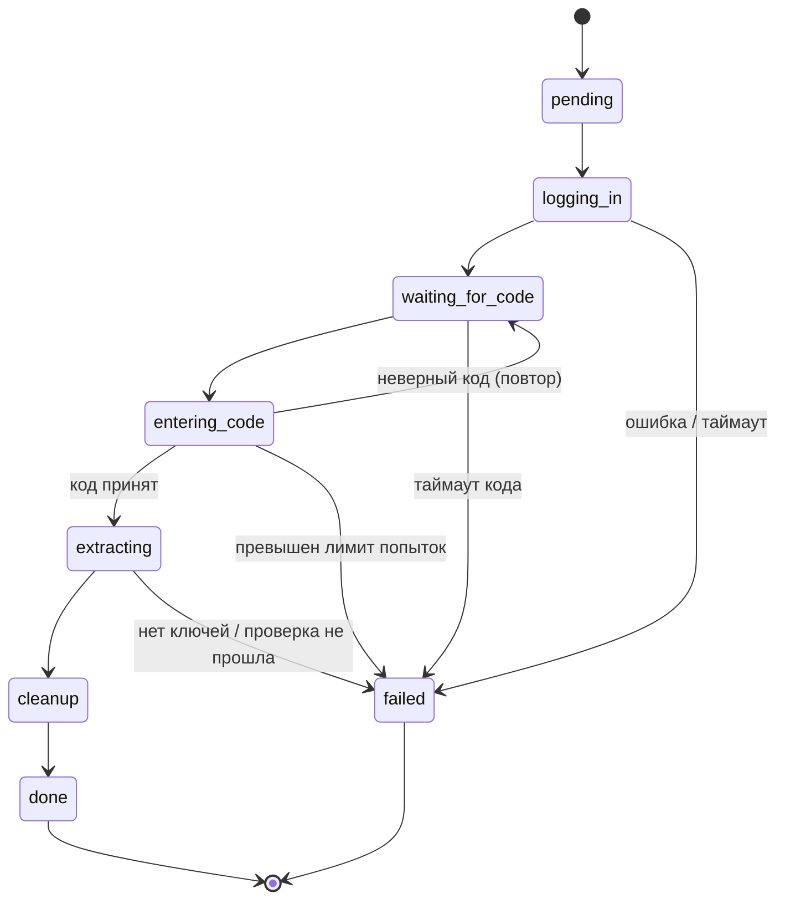
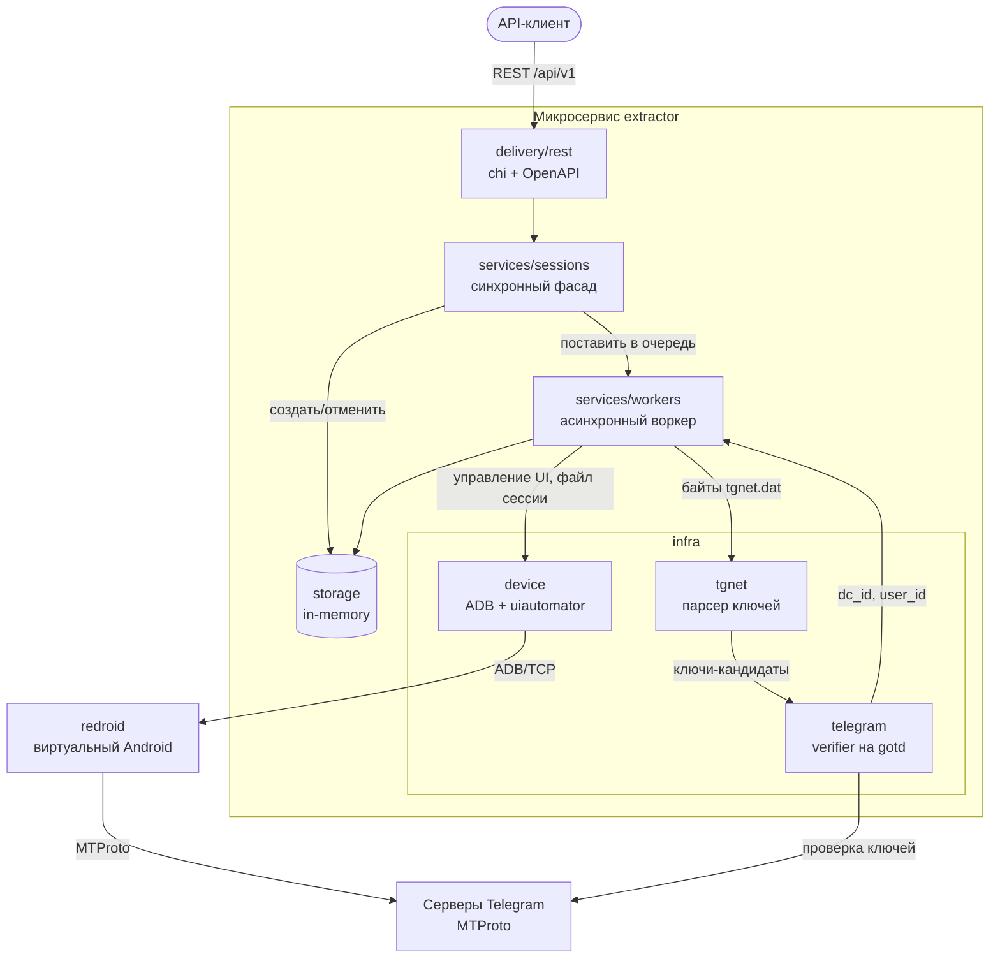
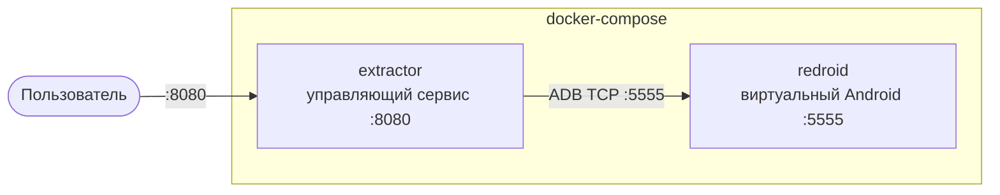

# Документация исследования

Исследование к микросервису извлечения данных авторизации Telegram (`auth_key`, `dc_id`, `user_id`) из виртуального Android. Документ обосновывает выбор виртуального Android, метода управления устройством и способа извлечения данных сессии, а также фиксирует конфигурацию, жизненный цикл и архитектуру комплекса.

Оценки в сравнительных таблицах — относительные (под критерии задачи), а не абсолютные бенчмарки; каждая снабжена кратким обоснованием.

---

## 1. Выбор виртуального Android

### 1.1. Сравнительная таблица решений

| Критерий | **redroid** | Android Emulator (AVD) | Waydroid | Anbox | Genymotion |
|---|---|---|---|---|---|
| **Производительность** | Высокая — контейнер на ядре хоста, без аппаратной виртуализации | Средняя — нужен KVM/HAXM; эмулируется весь стек | Высокая — контейнер на ядре хоста | Средняя — контейнер, но проект устарел | Высокая — на базе VirtualBox/облака |
| **Доступность API** | Полный Android по ADB/TCP | Полный Android + эмулятор-специфичные команды (`emu`), `adb root` на образах без Google Play | Полный Android, но завязан на локальный Wayland-дисплей | Ограниченная, компоненты устарели | Полный + собственный GPS/сенсоры API |
| **Интеграция с Docker** | Нативная — официальный образ, запускается как сервис | Через сторонние образы, требует вложенной виртуализации (KVM) | Частичная — рассчитан на desktop-сессию, не headless | Слабая, официальных образов нет | Облачная (платно), десктоп не контейнеризуется |
| **Конфигурация параметров** | Через `androidboot.*` флаги: разрешение, DPI, GPU, память | Через AVD-конфиг и параметры запуска | Ограниченная, свойства Android | Минимальная | Через GUI/API (платно) |
| **Headless / server-side** | Да, спроектирован под это | Частично (`-no-window`) | Нет, нужен дисплей | Частично | Да (облако) |
| **Лицензия / стоимость** | Открытый, бесплатный | Бесплатный (Android SDK) | Открытый, бесплатный | Открытый, развитие остановлено | Коммерческий |
| **Требование к хосту** | Linux-ядро с `binder`/`ashmem` (или `binderfs`/`memfd`) | x86-хост с поддержкой виртуализации | Linux + Wayland | Linux | Отдельная ВМ / облако |

### 1.2. Вывод

Для продакшн-окружения выбран **redroid**: это единственное решение, которое запускается как обычный Docker-сервис рядом с управляющим микросервисом, не требует аппаратной виртуализации (вложенный KVM в контейнере — боль в CI/облаке) и предоставляет полный доступ по ADB. Anbox фактически заброшен, Waydroid завязан на локальный графический сеанс и плохо подходит под headless-сервер, Genymotion коммерческий.

Ограничение redroid принято осознанно: он запускает Android на **ядре хоста**, поэтому требует Linux с модулями `binder`/`ashmem` (или кастомного ядра с `binderfs`/`memfd`) и не работает на стоковом Docker Desktop для macOS/Windows.

Поэтому для **локальной разработки** используется **Android Emulator (AVD)** из Android Studio — он кроссплатформенный и даёт `adb root` на образах без Google Play. Оба варианта скрыты за одним ADB-интерфейсом, поэтому переключение между ними — это смена конфига (`config/redroid.yaml` ↔ `config/local.yaml`), а не кода.

---

## 2. Спецификация конфигурации выбранного Android

### 2.1. Образ и версия

| Параметр | Значение |
|---|---|
| Образ | `redroid/redroid:13.0.0-latest` |
| Версия Android | 13 (API 33) |
| Архитектура | по архитектуре хоста (x86_64 / arm64) |

### 2.2. Требования к ресурсам

| Ресурс | Требование |
|---|---|
| CPU | 2+ ядра (один активный сеанс Telegram) |
| RAM | ≥ 2 ГБ на контейнер redroid |
| Хранилище | ≥ 2 ГБ под `/data` (образ + сессия приложения + APK) |
| Ядро хоста | Linux с `binder` и `ashmem`/`binderfs`; смонтированный `/dev/binderfs` |

### 2.3. Параметры контейнера (`docker-compose.yml`)

```yaml
redroid:
  image: redroid/redroid:13.0.0-latest
  privileged: true                       # доступ к binder/драйверам ядра
  command:
    - androidboot.redroid_width=720
    - androidboot.redroid_height=1280
    - androidboot.redroid_dpi=320
  volumes:
    - redroid-data:/data                 # персистентность состояния Android
    - /dev/binderfs:/dev/binderfs        # binder с хоста
```

- **`privileged: true`** — обязателен: redroid использует драйверы ядра хоста (binder), без привилегий контейнер не стартует.
- **Разрешение `720×1280`, DPI `320`** — фиксированный форм-фактор телефона. Это важно для управления через UI: экраны Telegram (раскладка полей ввода, кнопок) стабильны и предсказуемы, а определение элементов идёт по дереву UI, а не по абсолютным координатам.
- **`redroid-data:/data`** — том сохраняет установленный Telegram и состояние между перезапусками; `pm clear` между задачами возвращает приложение в чистое состояние, не трогая сам образ.

### 2.4. Доступ и разрешения

- **`adb root`** — нужен для чтения приватного хранилища приложения (`/data/data/<pkg>/...`). Поэтому образ Android должен быть **без Google Play** (на Play-образах root заблокирован).
- Подключение к redroid — по **TCP** (`adb connect redroid:5555`, см. `adb.needs_connect: true`), к локальному эмулятору — по стандартному serial (`emulator-5554`).

---

## 3. Выбор метода управления Android

### 3.1. Сравнительная таблица методов

| Критерий | **ADB + uiautomator** | Appium (UiAutomator2) | scrcpy | Maestro | Frida |
|---|---|---|---|---|---|
| **Готовые библиотеки** | ADB — штатная утилита; обёртки для Go есть, но тонкие | Зрелые клиенты (Java, Python, JS); Go — слабо | Протокол/CLI, Go-биндингов почти нет | CLI + YAML, не библиотека | Биндинги есть, но под инъекцию |
| **Кол-во параметров настройки** | Минимум — CLI-команды `shell`, `input`, `pull` | Очень много (capabilities, драйверы) | Мало (видео/ввод) | Среднее (YAML-флоу) | Много (скрипты инъекции) |
| **Документация / коммьюнити** | Огромное (ADB — отраслевой стандарт) | Большое, но тяжеловесное | Среднее | Растущее | Нишевое |
| **Скорость отклика** | Высокая (прямые shell-команды) | Средняя (прослойка сервер+драйвер) | Высокая (стрим), но нет дерева UI | Средняя | Высокая, но хрупкая |
| **Надёжность** | Высокая (нет внешних агентов на устройстве) | Средняя (зависит от сервера на устройстве) | Низкая для автоматизации (пиксели) | Средняя | Низкая (ломается от версии к версии) |
| **Гибкость** | Высокая — полный доступ к shell, ФС, su | Высокая, но в рамках WebDriver | Низкая (только экран+тап) | Низкая (сценарный DSL) | Очень высокая (хуки в процесс) |
| **Программная автоматизация** | Полная, легко встраивается в сервис | Полная, но тяжёлая зависимость | Плохо автоматизируется программно | Внешний раннер, не встроить | Полная, но нестабильная |
| **Зависимости на устройстве** | Нет (uiautomator встроен в Android) | APK-агент (UiAutomator2 server) | Серверный бинарь (пушится) | JVM-раннер | Frida-server (root) |

### 3.2. Вывод

Выбран **ADB + uiautomator**:

- **Минимум зависимостей.** `uiautomator dump` встроен в Android, отдельный агент/APK ставить не нужно — меньше точек отказа, чем у Appium или Frida.
- **Прямой доступ ко всему.** Через `adb shell` доступны ввод (`input text`/`tap`/`keyevent`), файловая система, `su`, `pm clear` — ровно то, что нужно и для управления UI, и для извлечения файла сессии, одним инструментом.
- **Надёжность вместо хрупкости.** Appium тянет серверный агент на устройство; Frida ломается от версии к версии; scrcpy отдаёт только пиксели и не даёт дерево элементов. ADB+uiautomator не зависит от внутренностей клиента Telegram.
- **Определение по дереву UI, а не по координатам.** Переходы между экранами детектируются опросом дерева элементов (`uiautomator dump` → XML), что устойчивее слепых тапов по фиксированным точкам.

Цена выбора — тонкая прослойка Go поверх `adb` пишется вручную (нет жирной библиотеки), но это окупается надёжностью и простотой.

---

## 4. Описание выбранного метода и способа интеграции

### 4.1. Слой ADB

Микросервис вызывает бинарь `adb` как подпроцесс (`os/exec`) и оборачивает нужные команды (`internal/infra/device/adb.go`):

| Операция | Команда ADB | Назначение |
|---|---|---|
| Подключение | `adb connect <serial>` | TCP-подключение к redroid |
| Root | `adb root` | Доступ к приватному хранилищу |
| Запуск приложения | `adb shell monkey -p <pkg> ...` | Старт Telegram |
| Ввод текста | `adb shell input text <...>` | Ввод номера/кода |
| Тап | `adb shell input tap <x> <y>` | Нажатие по центру элемента |
| Клавиши | `adb shell input keyevent <code>` | Очистка поля (MOVE_END + DEL) |
| Дамп UI | `adb shell uiautomator dump` | Снимок дерева элементов |
| Чтение сессии | `adb exec-out su 0 cat <tgnet.dat>` | Бинарный вывод файла сессии |
| Сброс | `adb shell pm clear <pkg>` | Очистка состояния приложения |

### 4.2. Определение экранов через uiautomator

1. `uiautomator dump` сохраняет XML-дерево текущего экрана, сервис его читает (`cat`) и парсит (`internal/infra/device/uiautomator.go`).
2. Дерево «расплющивается» в список элементов (`Element`: `text`, `resource-id`, `class`, `content-desc`, `bounds`), координаты парсятся из `bounds` (`internal/infra/device/elements.go`).
3. Экраны и элементы ищутся **матчерами** (`ByText`, `ByContentDesc`, `ByResourceID`, `ByTextContains`, `And`/`Or`) — например, экран ввода номера = наличие `content-desc="Phone number"`, успех входа = `Search Chats` или `… unread chats`.
4. Клик вычисляется как центр `bounds` найденного элемента и выполняется `input tap` — слепые координаты не используются.
5. Известные попапы (запрос разрешений, «Update Telegram», подтверждение номера, ANR) закрываются автоматически по мере появления в дереве (`dismissables` в `screen.go`).

Опрос идёт с интервалом (`adb.wait_interval`) до появления ожидаемого экрана или таймаута (`adb.wait_timeout` / `phone_check_timeout`).

### 4.3. Авто-провижининг Telegram

Если пакет не установлен (`pm list packages`), сервис скачивает APK с `apk_url` (с ретраями) и ставит через `adb install -r` (`internal/infra/device/install.go`).

---

## 5. Спецификация извлечения данных

### 5.1. Локация файла

```
/data/data/org.telegram.messenger.web/files/tgnet.dat
```

Файл лежит в приватном хранилище приложения — чтение требует **root** (`su`). Сервис читает его бинарно через `adb exec-out su 0 cat <path>` (бинарный поток без искажений переводом строк).

### 5.2. Что извлекаем

| Поле | Тип | Источник |
|---|---|---|
| `auth_key` | 256 байт | Прямо из `tgnet.dat` |
| `dc_id` | int (1–5) | Определяется эмпирически (см. 5.4), **не** читается из файла |
| `user_id` | int64 | Возвращается Telegram при переавторизации |

### 5.3. Структура хранения ключа в `tgnet.dat`

`tgnet.dat` хранит для каждого датацентра **permanent** `auth_key` (256 байт), за которым следует его 8-байтный `auth_key_id`:

```
auth_key_id = SHA1(auth_key)[12:20]   // младшие 64 бита SHA1 ключа
```

```
┌──────────────────────────────┬──────────────────┐
│      auth_key (256 байт)      │ auth_key_id (8)  │
└──────────────────────────────┴──────────────────┘
                                 = SHA1(auth_key)[12:20]
```

### 5.4. Алгоритм парсинга (криптографический якорь)

Вместо привязки к раскладке полей файла (которая меняется от версии клиента) парсер опирается только на криптографический инвариант (`internal/infra/tgnet/parser.go`):

1. Скользящим окном по файлу берётся 256-байтный блок и следующие за ним 8 байт.
2. Блок считается ключом **тогда и только тогда**, когда `SHA1(block)[12:20]` равен этим 8 байтам.
3. Вероятность случайного совпадения — 1/2⁶⁴, поэтому ложных срабатываний практически нет.
4. Дубликаты по `auth_key_id` отбрасываются.

`dc_id` в файле хранится, но не является частью этого инварианта, поэтому домашний датацентр определяется **эмпирически** на этапе проверки, а не парсингом: все найденные ключи-кандидаты параллельно пробуются против датацентров Telegram (gotd), и тот, по которому проходит `users.getUsers(InputUserSelf)`, даёт реальные `dc_id` и `user_id`.

Такой подход устойчив к смене формата `tgnet.dat` между версиями Telegram.

---

## 6. Алгоритм жизненного цикла

### 6.1. Этапы

1. **Запуск контейнера.** `docker-compose up` поднимает redroid и управляющий сервис. На старте сервис подключается к устройству (`adb connect`), включает root и при необходимости ставит Telegram (скачивает APK).
2. **Постановка задачи.** `POST /api/v1/sessions` с номером телефона создаёт задачу и ставит её в очередь воркера (идемпотентно: активная задача по тому же номеру переиспользуется). Ответ — сразу, обработка — асинхронная.
3. **Авторизация.** Воркер запускает Telegram, определяет экран ввода номера по дереву UI, вводит номер, подтверждает. Задача переходит в `waiting_for_code` и блокируется до прихода кода.
4. **Ввод кода.** Код приходит через `POST /api/v1/sessions/{id}/code`, вводится в поле. Неверный код детектируется по экрану и повторяется до лимита попыток; отсутствие кода — таймаут.
5. **Извлечение.** По достижении списка чатов `tgnet.dat` читается с устройства и парсится во все permanent-ключи.
6. **Проверка.** Ключи-кандидаты параллельно пробуются против датацентров; первый авторизовавшийся даёт `dc_id` и `user_id`.
7. **Очистка.** Независимо от исхода устройство сбрасывается `pm clear`, чтобы следующая задача стартовала с чистого состояния.
8. **Результат.** При статусе `done` данные доступны через `GET /api/v1/sessions/{id}/result`.

### 6.2. Диаграмма состояний задачи



---

## 7. Архитектура

### 7.1. Компоненты и потоки данных



### 7.2. Принципы

- **Чистая слоёная архитектура.** Зависимости направлены внутрь: `delivery → services → domain`, `infra` реализует интерфейсы, объявленные в `services`. `domain` не знает о фреймворках.
- **Разделение sync/async.** `sessions.Service` — быстрый фасад для REST (создать задачу, отдать статус, передать код). `workers.Worker` ведёт долгий жизненный цикл извлечения в фоне.
- **Одно устройство — один воркер.** Виртуальным устройством владеет один воркер, поэтому одновременно идёт одна задача; остальные ждут в буферизированном канале-очереди.
- **Заменяемость.** Интерфейсы объявлены у потребителя, поэтому эмулятор ↔ redroid и in-memory ↔ БД меняются конфигом/реализацией, а не переписыванием логики.

### 7.3. Два контейнера (`docker-compose.yml`)



---

## Источники

- [redroid-doc (официальная документация)](https://github.com/remote-android/redroid-doc)
- [redroid-modules (требования к ядру хоста)](https://github.com/remote-android/redroid-modules)
- [Waydroid / Anbox / Genymotion — сравнение](https://tech-insider.org/waydroid-vs-anbox-vs-genymotion-2026/)
- [UI Automator vs Appium](https://kobiton.com/guides/ui-automator-vs-appium-android-ui-testing/)
- [Maestro vs Appium](https://toolradar.com/compare/maestro-vs-appium)
- [gotd/td (MTProto-клиент для проверки)](https://github.com/gotd/td)
